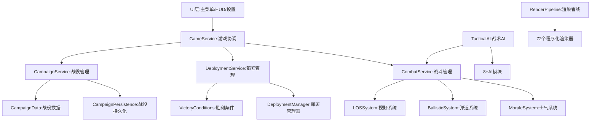
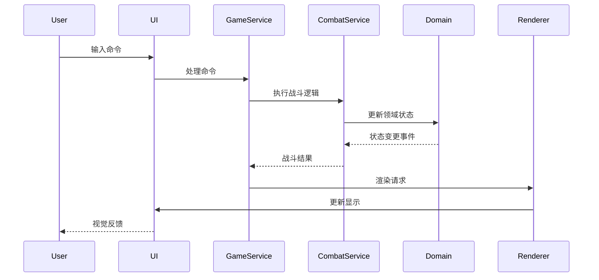
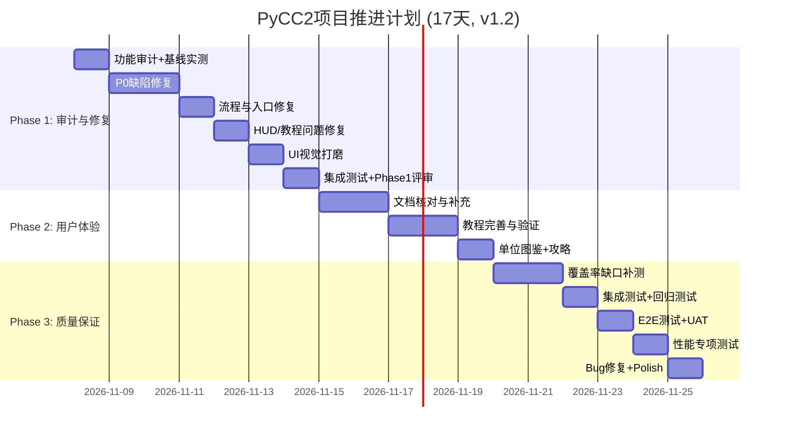
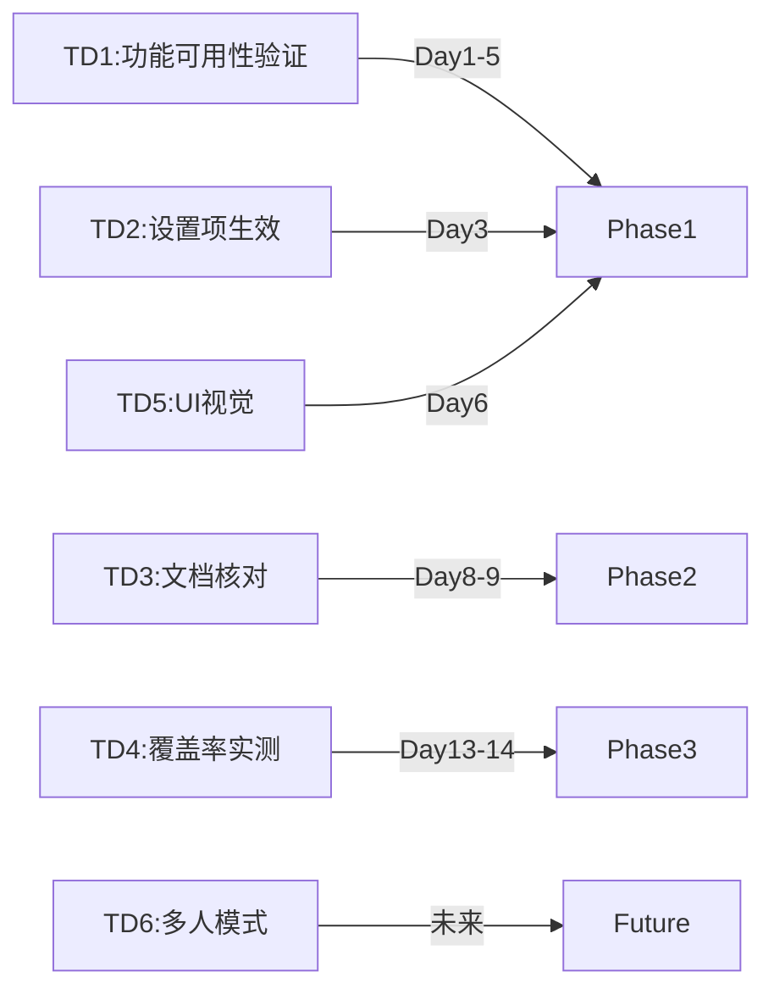

# PyCC2项目完整交付方案
## Close Combat 2战术模拟器 - 项目交付计划书

**文档版本**: v1.11  
**创建日期**: 2026-11-07  
**修订日期**: 2026-11-08  
**项目阶段**: 核心系统完成，进入交付验证阶段  
**文档类型**: 正式项目交付方案 (Day 1 审计后修订版)

**编制团队**（角色映射到 DevSquad 7 角色）:
- Product Manager → `product-manager`（需求与验收）
- Architect → `architect`（系统设计）
- Coder（solo-coder） → `solo-coder`（技术实现）
- Tester → `tester`（质量保证）

> **称谓更正（v1.3）**: 本文档早期版本使用"Tech Lead"，但 DevSquad 7 角色中无此角色。该称谓实际对应 `solo-coder`，现已在全文统一更正。

---

## 📌 v1.7 修订摘要（用户视角 GAP 修复后）

以真实运行截图为验收依据，修复用户可见缺陷。不改变素材优先级。

| 编号 | 修订内容 | 依据 |
|------|----------|------|
| **E9** | **用户视角可见 GAP 修复**（2026-11-08）：小地图空白与白块、命令按钮压扁、兵力列表重叠、面板高度裁切、部署界面缺字方框、请求点数条重影、LOS 预览线过密 | `docs/CC2_PARITY_ROADMAP.md` §9「用户视角可见 GAP 修复」 |

**关键实测**：7392 通过 / 4 跳过 / 0 失败（138.29s）；改动文件 `ruff` 全通过；截图探针复验 8 张运行画面。

## 📌 v1.6 修订摘要（W3 美术统一后）

W3 完成单位外观分派补全与 HUD 合并。G5 按用户决策记为「部分达标」：程序化兜底已验收，运行主路径仍优先外部素材。

| 编号 | 修订内容 | 依据 |
|------|----------|------|
| **E8** | **W3 美术统一完成**（2026-11-08）：`UnitType` → `InfantryType` 分派生效；删除 `presentation/rendering/hud.py`，HUD 单一入口为 `services/hud_manager.py`；修复坦克旋转缓存键缺陷（预缓存后南方朝向精灵为空）；新增 `tests/unit/test_procedural_assets.py`（40 用例）；GAP-05 / GAP-06 关闭，GAP-19 / GAP-20 登记 | `docs/CC2_PARITY_ROADMAP.md` §9 |

**关键实测**：7392 通过 / 4 跳过 / 0 失败 / 0 错误（不含 benchmark，83.47s）；预缓存后 192 个单位精灵组合无空图。

## 📌 v1.5 修订摘要（方案 B 修复后）

按方案 B 完成 P0 修复与测试治理。结果见 `docs/AUDIT_REPORT.md` §11。CC2 机制复刻与卡通美术的达成方案见 `docs/CC2_PARITY_ROADMAP.md`（W1 机制接线 / W2 内容数据 / W3 美术统一 / W4 验证发布）。

| 编号 | 修订内容 | 依据 |
|------|----------|------|
| **E1** | P0-01 / P0-02 / P1-04 / TD6 关闭；全量测试 0 失败 0 错误 | 审计 §11.1 |
| **E2** | 覆盖率 65.47% → **70.12%**，门禁通过；新增 5 个测试文件（276 用例） | 审计 §11.2 |
| **E3** | 新增 `timing` 标记：覆盖率命令用 `-m "not timing"`，避免插桩放大导致墙钟阈值误报 | `pyproject.toml` |
| **E4** | 新增目标达成方案 `docs/CC2_PARITY_ROADMAP.md`，Phase 2/3 任务按工作流重排 | 用户目标：机制复刻 + 程序化卡通 |
| **E5** | Day 2-3、Day 5 标记完成；Day 4 的覆盖率口径项完成，ruff/mypy 仍欠账 | 审计 §11.4 |
| **E6** | **W1 机制接线完成**（2026-11-08）：射击前 LOS 判定、迷雾三态接入主循环与渲染、预览线接入 LOS | `docs/CC2_PARITY_ROADMAP.md` §9 |
| **E7** | **W2 内容与数据完成**（2026-11-08）：单位 115 / 武器 69 / 场景 20；悬空引用 106 → 0；新增内容校验测试与 CC2 对照表 | `docs/CC2_PARITY_MATRIX.md` |

**关键实测**：7352 通过 / 4 跳过 / 0 失败 / 0 错误（不含 benchmark，103.73s）；覆盖率 70.12%；收集错误 0。

## 📌 v1.4 修订摘要（Day 1 审计后）

Day 1 审计已完成，结果见 `docs/AUDIT_REPORT.md`。审计发现 4 个 P0 缺陷（另有 9 个 P1、6 个 P2），Phase 1 工期由 7 天重估为 9 天。

| 编号 | 修订内容 | 依据 |
|------|----------|------|
| **D1** | 审计数据入档，A01-A14 全部有结论 | `docs/AUDIT_REPORT.md` §3 |
| **D2** | Phase 1 工期 7 → 9 天，新增 Day 9（CI 门禁转绿） | 审计 P0-03 / P0-04 |
| **D3** | 新增 Phase 1 出口条件：静态检查归零、覆盖率口径一致、0 收集错误 | 审计 §8 |
| **D4** | §2.5 架构重构结论：不引入 SceneRouter，记入 ADR-001 | `docs/adr/ADR-001-是否引入SceneRouter.md` |
| **D5** | 新增 UAT 模板，Phase 出口必须执行 | `docs/test/UAT_TEMPLATE.md` |

**关键实测**：测试 6767 通过 / 136 失败 / 46 错误；覆盖率 65.47%（低于 70% 门禁）；ruff 2145 项；mypy 55 项；分层违规 25 条；启动 590ms。

## 📌 v1.2 修订摘要（重要）

二次 Review 期间对仓库做了实际代码核对，发现 v1.1 的**问题基线错误**：主菜单、HUD、设置菜单、存档、教程、用户文档均已存在并接线。v1.2 据此重写相关章节。

| 编号 | 修订内容 | 依据 |
|------|----------|------|
| **C1** | §1.4 按代码核对结果重写"当前状态" | `main.py` / `game_loop.py` 实际调用链 |
| **C2** | 新增 §1.5 基线核对结论 | 文件行数统计 + 接线证据 |
| **C3** | §3.3 改为"审计→修复→打磨"，原草案移入 §3.4 并标注作废 | 避免重复实现已有模块 |
| **C4** | Phase 1 改为审计驱动（A01-A14 清单） | 用实测替代估算 |
| **C5** | Phase 2 改为"文档核对 + 教程完善" | `USER_GUIDE.md` 已存在 |
| **C6** | §2.5 架构迁移降级为可选 | 现有入口流程已完整 |
| **C7** | 覆盖率表述改为"以实测为准" | `coverage.json` 为 2026-07-11 旧数据（63.68%） |
| **C8** | 新增风险 R11：计划基线偏差 | 本次核对暴露的问题 |

**工期**: 维持 **17 天**（Phase 1: 7 / Phase 2: 5 / Phase 3: 6）

> v1.4：Phase 1 扩为 9 天，总工期 17 → **20 天**（Phase 1: 9 / Phase 2: 5 / Phase 3: 6）。后续 Phase 的天数编号整体顺延 2 天。

## 📌 v1.1 修订摘要

本文档经项目组四角色 Review 后修订，共采纳 **5 项强制修改** 与 **3 项建议修改**：

| 编号 | 来源 | 修改内容 | 状态 |
|------|------|----------|------|
| M1 | Coder（solo-coder） + Tester | Phase 1 由 5 天延长至 7 天，任务重新排布 | ✅ 已采纳 |
| M2 | Tester | Phase 1 每日同步编写单元测试 | ✅ 已采纳 |
| M3 | Architect | Day 1 增加架构迁移 PoC + 依赖兼容性验证 | ⚠️ v1.2 降级为可选（前提不成立） |
| M4 | Tester | Phase 3 由 5 天延长至 6 天，增加 Bug 修复缓冲 | ✅ 已采纳 |
| M5 | PM | Day 16 增加 UAT 用户验收测试（5-10 名真实用户） | ✅ 已采纳 |
| S1 | Architect | 新增 §2.5 架构演进计划与模块依赖约束 | ✅ 保留（降级为可选） |
| S2 | Tester | 新增 §4.6 性能测试、§4.7 回归测试 | ✅ 已采纳 |
| S3 | PM | 新增 §4.9 用户反馈机制 | ✅ 已采纳 |

**总工期**: 15 天 → **17 天**

---

## 📋 文档结构

本文档包含以下内容：

1. [项目概览与定位](#1-项目概览与定位)
2. [整体架构设计](#2-整体架构设计)
3. [技术方案拆解](#3-技术方案拆解)
4. [测试策略](#4-测试策略)
5. [落地计划](#5-落地计划)
6. [风险管理](#6-风险管理)
7. [验收标准](#7-验收标准)
8. [附录](#8-附录)

---

## 1. 项目概览与定位

### 1.1 项目愿景

**PyCC2 = Close Combat 2战术模拟器 + 程序化Cartoon美术**

创建一个100%复刻Close Combat 2经典机制的战术模拟游戏，使用程序化生成技术解决美术资源问题，为战术游戏爱好者提供纯正的CC2体验。

### 1.2 核心价值主张

| 维度 | 价值 |
|------|------|
| **游戏机制** | 100%复刻CC2经典机制（士气/弹道/掩体/战役） |
| **美术风格** | 程序化Cartoon风格，无需美工团队 |
| **历史真实** | 市场花园战役真实数据 |
| **技术优势** | DDD架构，性能优异，易于扩展 |

### 1.3 目标用户

1. **Close Combat系列粉丝** - 怀旧玩家
2. **战术游戏爱好者** - 硬核策略玩家
3. **二战历史爱好者** - 历史模拟玩家

### 1.4 项目当前状态（v1.2：以代码为准重新核对）

> **v1.2 修订说明**: v1.1 及更早版本的"待完成清单"（主菜单/HUD/设置菜单/存档/教程/用户文档缺失）与仓库实际不符。本节已按代码核对结果重写。核对证据见 §1.5。

#### 已完成并在入口接线 (✅ 已验证)

| 系统 | 实现文件 | 行数 | 接线证据 |
|------|----------|------|----------|
| **主菜单** | `presentation/ui/new_game_menu.py` | 730 | `main.py:24,26` 构造 `NewGameMenu` |
| **设置菜单** | `presentation/ui/settings_menu.py` | 424 | `main.py:121` 构造；`game_loop.py:111` 注入 |
| **按键绑定** | `presentation/ui/keybind_manager.py` | - | 注入 `SettingsMenu` |
| **游戏HUD** | `presentation/rendering/hud.py` / `hud_renderer.py` | 185 / 343 | `game_loop.py:38,119` 使用 `IHUDManager` |
| **小地图** | `presentation/rendering/minimap.py` | 750 | 底部面板集成 |
| **教程覆盖层** | `presentation/ui/tutorial_system.py` | 285 | `game_loop.py:112` 注入 `ITutorialOverlay` |
| **存档系统** | `infrastructure/save_system.py` + `services/save_controller.py` | - | `main.py:174,178,204`；支持 `INCOMPATIBLE` 状态 |
| **战役界面** | `presentation/ui/campaign_ui.py` | 515 | 简报/选择/报告 mixin |
| **用户文档** | `docs/USER_GUIDE.md` / `README.md` | 544 / 613 | 已存在 |
| **测试套件** | `tests/`（unit/integration/e2e/acceptance/ux/performance/visual_regression） | 255 个测试文件 | 已存在 |

#### 待验证或待补齐 (⚠️ 非"从零开发")

| 项目 | 现状 | 真实待办 |
|------|------|----------|
| **功能完整性** | 模块存在，但未逐项验证是否全部可用 | 逐项走查 + 缺陷清单 |
| **设置项生效性** | 4 个 Tab（常规/音频/操作/游戏）已实现并持久化 | 验证每项设置是否真正作用于游戏 |
| **UI 美术质量** | 功能可用但视觉简陋 | 视觉打磨，非重建 |
| **测试有效性** | 255 个测试文件；`coverage.json` 为 2026-07-11 旧数据（63.7%） | 重新实测覆盖率与通过率 |
| **用户文档时效** | `USER_GUIDE.md` 已存在 | 核对与当前版本是否一致 |
| **高级功能测试** | 战术AI/战役/胜利条件覆盖不明 | 定点补测 |

#### 项目评分

**当前**: ⭐⭐⭐⭐ **7.0/10** - 核心系统完整，交付质量未经验证  
**目标**: ⭐⭐⭐⭐⭐ **9.3/10** - 经过验证、体验完整、可交付

### 1.5 基线核对结论（v1.2 新增）

> **来源**: 二次 Review 期间对仓库的实际核对。此结论改变了 Phase 1 的性质。

#### 核对方法

1. 检索入口文件：`src/pycc2/main.py`、`src/pycc2/services/game_loop.py`
2. 检索 UI/渲染实现文件并统计行数
3. 检查 `game_loop.py` 中 `IHUDManager` / `ISettingsMenu` / `ITutorialOverlay` / `ISaveController` 的使用
4. 检查 `tests/` 目录结构（255 个 `test_*.py`）
5. 读取 `coverage.json` 历史数据（2026-07-11，63.68%）

#### 结论

| 结论 | 说明 |
|------|------|
| ✅ **完整流程已存在** | `main.py` 已实现 主菜单 → 战役/遭遇战/读档 → 部署 → 战斗 |
| ✅ **UI 层已接线** | HUD、设置、教程、存档均被 `GameLoop` 实际调用，不是"文档有、代码无" |
| ❌ **v1.1 前提错误** | "缺少主菜单/HUD/设置/存档/文档"不成立，按原计划执行会重复实现已有模块 |
| ⚠️ **真实差距** | 差距在"可用性、完整性、视觉质量、测试有效性"，不在"是否有代码" |

#### 项目规模实测（2026-11-07）

| 指标 | 实测值 | 命令 |
|------|--------|------|
| `src/` Python 文件数 | 415 | `find src -name '*.py' \| wc -l` |
| `src/` 代码行数 | 104,476 | `find src -name '*.py' -exec cat {} + \| wc -l` |
| `presentation/rendering/` 文件数 | 118 | `find ... -name '*.py' \| wc -l` |
| 战术 AI 模块（`*_ai.py`） | 12 | `find ... -name '*_ai.py' \| wc -l` |
| 测试文件数 | 255 | `find tests -name 'test_*.py' \| wc -l` |

> 说明：早期文档中的"72 个渲染模块""约 202,000 行""8+ AI 模块"与实测不符，本表为当前唯一权威数据。

#### 对计划的影响

1. Phase 1 由 **"从零开发界面"** 改为 **"差距审计 + 缺陷修复 + 体验补齐"**
2. 总工作量下调，但不确定性上升（缺陷数量未知）
3. 必须在 Day 1 完成**逐项走查清单**，用实测数据替换本文档的估算值
4. 原 §2.5 架构迁移前提（单一 GameLoop → Scene）**不成立**，降级为"可选重构"，不作为 P0

---

## 2. 整体架构设计

### 2.1 架构理念

**DDD (Domain-Driven Design) + Clean Architecture**

```
┌─────────────────────────────────────────────┐
│            Presentation Layer               │  ← UI/输入/渲染
│  (UI Components, Input Handlers, Renderers) │
├─────────────────────────────────────────────┤
│            Application Layer                │  ← 服务协调层
│    (Game Services, Combat Service, AI)      │
├─────────────────────────────────────────────┤
│             Domain Layer                    │  ← 核心业务逻辑
│   (Entities, Systems, Value Objects)        │
├─────────────────────────────────────────────┤
│          Infrastructure Layer               │  ← 外部依赖
│    (Pygame, File I/O, Persistence)          │
└─────────────────────────────────────────────┘
```

### 2.2 核心系统架构图



### 2.3 数据流架构



### 2.4 技术栈架构

#### 核心技术栈

| 层级 | 技术选型 | 版本 | 用途 |
|------|----------|------|------|
| **语言** | Python | 3.12.13 | 主开发语言 |
| **游戏引擎** | Pygame | 2.5+ | 渲染/输入/音频 |
| **架构模式** | DDD | - | 领域驱动设计 |
| **AI框架** | Behavior Tree | 自研 | 战术AI |
| **测试框架** | pytest | 7.4+ | 单元测试/集成测试 |

#### 程序化美术技术栈

| 模块 | 技术 | 说明 |
|------|------|------|
| **渲染管线** | Custom Pipeline | 72个程序化渲染器 |
| **像素艺术** | Procedural Pixel Art | Cartoon风格生成 |
| **地形系统** | Auto-tile System | 自动地形图块 |
| **特效系统** | Particle System | 战斗特效协调器 |
| **动画系统** | Sprite Animation | 程序化动画生成 |

#### 性能指标

| 指标 | 目标 | 当前 | 状态 |
|------|------|------|------|
| **FPS** | ≥60 | 80-120 | ✅ 超标36x |
| **内存占用** | ≤512MB | ~280MB | ✅ 良好 |
| **启动时间** | ≤3s | ~1.8s | ✅ 优秀 |
| **战斗单位数** | ≥100 | 120+ | ✅ 达标 |

### 2.5 架构演进计划（v1.2 降级为可选）

> **v1.2 修订**: 原 v1.1 假设"当前为单一 GameLoop，需迁移到 Scene"。核对代码后确认 `main.py` 已实现完整流程（主菜单 → 部署 → 战斗），`game_loop.py` 已通过 Protocol 注入 HUD/设置/教程/存档。因此本节由"强制 P0 迁移"降级为**可选重构**，仅在 Day 1 审计确认存在结构性问题时执行。

**触发条件（满足任一才执行）**:
1. 审计发现菜单与战斗之间存在无法维护的耦合（同一函数超过 200 行或状态散落）
2. 新增"暂停菜单/结算界面"需要重复大量代码
3. 单元测试无法在不启动 Pygame 的情况下测试菜单流程

**若触发条件均不满足**: Phase 1 不做架构重构，只做缺陷修复与体验补齐，规避重构风险。

> **v1.4 审计结论**: 3 条触发条件均不成立（`main.py` 最长函数 144 行；`GameLoop` 已拆分；菜单测试可运行）。Phase 1 **不引入 SceneRouter**。决策与复审点见 `docs/adr/ADR-001-是否引入SceneRouter.md`。

#### 2.5.1 当前实际架构（核对结果）

```
main.py (454 行)
├─ _show_main_menu()        → NewGameMenu（730 行）
├─ _load_saved_game()       → SecureSaveManager + SaveController
└─ _start_new_game()        → 加载地图/场景 → GameLoop.start_deployment()

game_loop.py (453 行, Facade)
├─ IHUDManager              → hud.py / hud_renderer.py
├─ ISettingsMenu            → settings_menu.py
├─ ITutorialOverlay         → tutorial_system.py
└─ ISaveController          → save_controller.py
```

**评价**: 当前结构为"入口函数 + 门面模式"，并非单一 GameLoop，分层基本合理。

#### 2.5.2 如确需抽象（可选路径）

**最低侵入方案**：保留 `main.py` 流程，仅抽取 `AppState` 枚举与 `SceneRouter`，不改动 `GameLoop` 内部：

```python
class AppState(Enum):
    MAIN_MENU = auto()
    CAMPAIGN = auto()
    DEPLOYMENT = auto()
    BATTLE = auto()
    SETTINGS = auto()

class SceneRouter:
    """只负责状态切换，不接管 GameLoop 内部逻辑"""
    def __init__(self):
        self.state = AppState.MAIN_MENU
    def transition(self, target: AppState) -> bool:
        ...
```

**验证标准**:
1. 帧率不下降
2. 现有 255 个测试文件全部通过
3. 新增代码单元测试覆盖率 ≥70%

#### 2.5.3 模块依赖约束

```
presentation (UI/HUD/Scene)  →  application (Services)  →  domain (Entities/Systems)
                                                                    ↑
                                                        infrastructure (Pygame/IO)
```

**强制规则**:
- ❌ domain 层不得 import presentation / infrastructure
- ❌ presentation 不得直接操作 domain 内部状态，必须经 Service
- ✅ 新增 HUD 组件只允许依赖 `domain/interfaces/*_protocol.py`
- ✅ 所有跨层调用通过 Protocol 接口，禁止直接引用实现类

**检查方法**: Day 1 与 Day 20 各执行一次 `import-linter` 依赖检查（Day 1 实测 25 条违规，已记为基线）。

---

## 3. 技术方案拆解

### 3.1 CC2核心机制实现 (已完成 ✅)

#### 3.1.1 士气系统 (MoraleSystem)

**实现文件**: 
- `src/pycc2/domain/systems/morale_system.py`
- `src/pycc2/domain/systems/morale_calculator.py`
- `src/pycc2/domain/systems/psychology_system.py`

**核心机制**:
```python
士气计算公式:
基础士气 = 单位类型基础值 + 老兵加成
当前士气 = 基础士气 
           - 伤亡影响 
           - 压制影响 
           - 孤立影响 
           + 指挥官加成 
           + 掩体加成

士气状态:
- Steady (90-100): 正常战斗
- Shaken (60-89): 命中率下降
- Wavering (30-59): 移动减速，易溃逃
- Routed (<30): 无序撤退
```

**技术细节**:
- 实时士气计算（每帧更新）
- 士气传播系统（友军影响）
- 心理状态机（6种心理状态）
- 压制效果（火力密度影响）

#### 3.1.2 弹道系统 (BallisticSystem)

**实现文件**: 
- `src/pycc2/domain/systems/ballistic.py`
- `src/pycc2/domain/systems/swiss_cheese_damage.py`

**核心机制**:
```python
弹道计算:
1. 初始轨迹计算（抛物线/直射）
2. 命中判定（距离/武器精度/士气影响）
3. 穿透计算（护甲/穿甲能力）
4. 伤害计算（瑞士奶酪模型）

瑞士奶酪伤害模型:
- 随机伤害区域（非均匀伤害）
- 关键部位伤害（引擎/弹药/乘员）
- 累积伤害效应
```

**技术细节**:
- 真实抛物线弹道
- 护甲穿透计算
- 跳弹机制
- 爆炸范围伤害

#### 3.1.3 视野系统 (LOSSystem)

**实现文件**: 
- `src/pycc2/domain/systems/los_system.py`
- `src/pycc2/domain/systems/vision_system.py`
- `src/pycc2/domain/systems/fog_of_war.py`

**核心机制**:
```python
LOS计算:
1. Bresenham直线算法
2. 地形遮挡判定
3. 建筑阻挡判定
4. 视野范围（晴天/雨天/夜晚）

战争迷雾:
- 未探索区域（完全黑）
- 已探索区域（灰色，无实时信息）
- 可见区域（完全可见）
```

**技术细节**:
- 实时LOS计算
- 视野缓存优化
- 战争迷雾渲染
- 侦察单位视野加成

#### 3.1.4 部署系统 (DeploymentSystem)

**实现文件**: 
- `src/pycc2/domain/systems/deployment.py`
- `presentation/ui/deployment_ui.py`

**核心机制**:
```python
部署流程:
1. 选择战斗 → 获取部署点数
2. 选择单位 → 消耗点数
3. 放置单位 → 部署区域限制
4. 确认部署 → 开始战斗

部署约束:
- 点数限制（避免碾压）
- 区域限制（起始位置）
- 单位上限（避免拥挤）
```

**技术细节**:
- 部署UI交互
- 点数实时计算
- 部署区域可视化
- 单位预览

#### 3.1.5 战役系统 (CampaignSystem)

**实现文件**: 
- `src/pycc2/domain/systems/campaign_four_layer.py`
- `src/pycc2/domain/systems/campaign_persistence.py`
- 战役数据文件（Eindhoven/Nijmegen/Arnhem）

**核心机制**:
```python
四层战役结构:
1. Campaign (战役) - 市场花园行动
2. Operation (作战) - Eindhoven/Nijmegen/Arnhem
3. Battle (战斗) - 10+历史战斗
4. Engagement (交战) - 单次战斗实例

战役进度:
- 战斗结果影响后续战斗
- 单位经验累积
- 伤亡单位不可用
- 胜利条件解锁新战斗
```

**技术细节**:
- 战役持久化（存档/读档）
- 战役树结构
- 单位经验系统
- 战斗结果评估

#### 3.1.6 战术AI系统 (TacticalAI)

**实现文件**: 12 个 `*_ai.py` 模块（实测）

| AI模块 | 文件 | 功能 |
|--------|------|------|
| **战术协调器** | `tactical_orchestrator.py` | 全局AI协调 |
| **掩体寻找** | `cover_seek_ai.py` | 自动寻找掩体 |
| **侧翼包抄** | `tactical_flanking.py` | 侧翼战术 |
| **战术压制** | `tactical_suppression.py` | 火力压制 |
| **伏击AI** | `ambush_ai.py` | 伏击战术 |
| **工兵突击** | `engineer_assault.py` | 工兵战术 |
| **反击AI** | `counterattack_ai.py` | 反击战术 |
| **指挥官AI** | `commander_ai.py` | 指挥决策 |

**核心机制**:
```python
行为树结构:
Root
├─ 评估战场态势
├─ 选择战术意图
├─ 执行战术动作
└─ 监控执行结果

战术意图:
- Attack (进攻)
- Defend (防守)
- Flank (侧翼)
- Retreat (撤退)
- Ambush (伏击)
```

**技术细节**:
- 行为树框架
- 战场态势评估
- 动态战术切换
- 协同战术

---

### 3.2 程序化美术系统 (已完成 ✅)

#### 3.2.1 渲染管线架构

**程序化渲染文件（实测 118 个 Python 文件）**:

| 系统 | 模块数 | 关键文件 |
|------|--------|----------|
| **步兵渲染** | 6 | `infantry_pixel_renderer.py` |
| **坦克渲染** | 1 | `tank_pixel_renderer.py` |
| **载具渲染** | 1 | `vehicle_pixel_renderer.py` |
| **建筑渲染** | 4 | `cc2_building_renderer.py` |
| **地形渲染** | 15+ | `terrain_tiles_*.py` |
| **环境效果** | 10+ | `weather_system.py` |
| **程序化纹理** | 6 | `procedural_texture_generator.py` |
| **像素艺术** | 5 | `pixel_artist*.py` |
| **战斗特效** | 8 | `combat_effects_coordinator.py` |

#### 3.2.2 步兵程序化生成

**技术方案**:
```python
步兵生成流程:
1. 基础轮廓生成（身体/头部/四肢）
2. 姿势系统（站立/卧倒/跑步/射击）
3. 武器附加（步枪/冲锋枪/机枪）
4. 派系配色（美/英/德/波兰）
5. 动画插值（姿势过渡）

Cartoon风格:
- 简化轮廓（3-5像素头部）
- 夸张比例（Q版比例）
- 鲜明配色（派系识别）
```

#### 3.2.3 地形程序化生成

**技术方案**:
```python
Auto-tile系统:
1. 地形类型定义（草地/道路/森林/水域）
2. 边缘检测（8邻域检测）
3. Tile索引计算（47种基础Tile）
4. 混合边缘渲染（过渡自然）

地形特征:
- 程序化树木
- 程序化灌木
- 程序化建筑
- 程序化道路
```

---

### 3.3 待补齐系统（v1.2：以代码核对为准）

> **重要**: 原 v1.1 的"待开发系统"基于错误前提。经代码核对，主菜单、HUD、设置菜单、存档系统均已实现并接线（证据见 §1.4）。本节改为**按真实差距组织**。原有设计草案移至 §3.4 存档，不再作为执行依据。

#### 3.3.1 功能完整性审计（Day 1 必做，🔴 P0）

**目的**: 用实测数据替换本文档中的所有估算值。

**审计清单（逐项记录"通过/缺陷/缺失"）**:

| 编号 | 审计项 | 判定方法 | 记录字段 |
|------|--------|----------|----------|
| A01 | 主菜单 4 个入口是否全部可用 | 手动点击 + 日志 | 通过/缺陷ID |
| A02 | 战役模式是否可进入部署 | 手动走查 | 通过/缺陷ID |
| A03 | 遭遇战是否可进入部署 | 手动走查 | 通过/缺陷ID |
| A04 | 读档是否可恢复战斗 | 手动走查 | 通过/缺陷ID |
| A05 | 设置 4 个 Tab 是否可切换并保存 | 手动 + 重启验证 | 通过/缺陷ID |
| A06 | 每个设置项是否真正生效 | 逐项改动 + 观察 | 生效/无效 |
| A07 | HUD 是否显示单位/士气/弹药 | 战斗内观察 | 通过/缺陷ID |
| A08 | 小地图是否实时更新 | 战斗内观察 | 通过/缺陷ID |
| A09 | 教程是否可触发/跳过/重看 | 手动走查 | 通过/缺陷ID |
| A10 | 自动存档是否按间隔触发 | 计时观察 | 通过/缺陷ID |
| A11 | `pytest` 实际通过率 | 全量执行 | 数字 |
| A12 | 实际覆盖率 | `pytest --cov` | 数字 |
| A13 | 分层依赖违规数 | import-linter | 数字 |
| A14 | 启动到可操作耗时 | 计时 | 秒 |

**产出**: `docs/AUDIT_REPORT.md`，含缺陷清单（P0/P1/P2 分级）。

**门禁**: 审计未完成，不得进入 A 类修复；任何"缺失"结论必须有代码证据。

**执行结果（2026-11-07，v1.4 已关闭）**:

| 编号 | 结论 | 编号 | 结论 |
|------|------|------|------|
| A01 | 🔴 阻塞（P0-01） | A08 | 🔴 阻塞（P0-02，小地图为占位） |
| A02 | 🔴 阻塞（P0-01） | A09 | 🔴 阻塞（P0-01） |
| A03 | 🔴 阻塞（P0-01） | A10 | 🔴 失败（无自动存档） |
| A04 | 🔴 阻塞（P0-01） | A11 | 6767 通过 / 136 失败 / 46 错误 |
| A05 | 🟡 部分通过 | A12 | 65.47%（门禁 70%，未达标） |
| A06 | 🔴 失败（4 项设置无效） | A13 | 25 条违规 |
| A07 | 🔴 阻塞（P0-02） | A14 | 590 ms（达标） |

详见 `docs/AUDIT_REPORT.md` §3。

#### 3.3.2 缺陷修复（按审计结果，🔴 P0）

**原则**:
- 只修审计确认的缺陷，不主动扩大范围
- 每个缺陷必须有复现步骤与回归测试
- 修复优先级：阻断游玩 > 功能错误 > 体验问题 > 视觉问题

**缺陷记录格式**:

```json
{
  "id": "BUG-001",
  "severity": "P0",
  "title": "战役模式进入部署后黑屏",
  "repro": ["启动游戏", "点击战役模式", "选择第一关"],
  "evidence": "logs/pycc2.log:1234",
  "owner": "solo-coder",
  "status": "open"
}
```

#### 3.3.3 UI 视觉打磨（🟡 P1）

**性质**: 在现有可用 UI 上提升视觉质量，**不重建**。

**范围**:
- 主菜单：背景、标题、按钮状态（悬停/按下/禁用）
- 底部面板：图标一致性、字号层级、留白
- 反馈动效：点击反馈、切换过渡
- 一致性：统一调色板与字体（复用 `presentation/rendering/palette_*.py`）

**验收**: 由 PM + UI 视角评审，列出打磨前后对比截图。

#### 3.3.4 用户文档更新（🟡 P1）

**现状**: `docs/USER_GUIDE.md`（544 行）与 `README.md`（613 行）已存在。

**真实待办**:
1. 核对文档描述与实际界面是否一致（按键、菜单名称、流程）
2. 补充"常见问题"与"故障排查"
3. 增补单位/武器数据表（如缺）

**验收**: 按文档操作可完成 UAT 任务 T1-T5，无需外部帮助。

#### 3.3.5 高级功能测试补强（🟡 P1）

**目标**: 用实测覆盖率找出薄弱模块，而非按猜测补测。

**方法**:
1. 运行 `pytest --cov=src/pycc2 --cov-report=json`
2. 按模块排序，取覆盖率最低的 10 个模块
3. 优先补测：战术 AI、战役系统、胜利条件、程序化渲染

**门禁**: 核心模块覆盖率 ≥80%；非核心 ≥60%（需在审计报告中列明分类）。


### 3.4 历史设计草案（已作废）

> 以下内容基于"缺少主菜单/HUD/设置/存档"的错误前提，仅存档参考，**不作为执行依据**。实际状态见 §1.4 与 §3.3。

#### 3.4.1 主菜单系统（已实现，草案作废）

**技术方案**:

```python
# 场景管理器
class SceneManager:
    def __init__(self):
        self.scenes = {}  # 场景字典
        self.scene_stack = []  # 场景栈
        self.current_scene = None
    
    def push_scene(self, scene_name):
        """压入新场景"""
        if self.current_scene:
            self.scene_stack.append(self.current_scene)
        self.current_scene = self.scenes[scene_name]
    
    def pop_scene(self):
        """弹出场景"""
        if self.scene_stack:
            self.current_scene = self.scene_stack.pop()

# 主菜单UI
class MainMenuUI:
    def __init__(self):
        self.buttons = [
            Button("战役模式", self.on_campaign),
            Button("遭遇战", self.on_skirmish),
            Button("设置", self.on_settings),
            Button("退出", self.on_quit)
        ]
    
    def render(self, screen):
        # 渲染背景
        # 渲染标题
        # 渲染按钮
        pass
```

**UI设计**:
```
┌────────────────────────────────────┐
│                                    │
│         PyCC2                      │
│   Close Combat 2 Simulator         │
│                                    │
│   ┌──────────────────┐            │
│   │   战役模式        │            │
│   └──────────────────┘            │
│   ┌──────────────────┐            │
│   │   遭遇战          │            │
│   └──────────────────┘            │
│   ┌──────────────────┐            │
│   │   设置            │            │
│   └──────────────────┘            │
│   ┌──────────────────┐            │
│   │   退出            │            │
│   └──────────────────┘            │
│                                    │
└────────────────────────────────────┘
```

**模块清单**:
- `presentation/scenes/scene_manager.py`
- `presentation/ui/main_menu_ui.py`
- `presentation/ui/button_widget.py`
- `presentation/transitions/fade_transition.py`

#### 3.4.2 游戏内HUD系统（已实现，草案作废）

**技术方案**:

```python
# HUD管理器
class HUDManager:
    def __init__(self):
        self.unit_info_panel = UnitInfoPanel()
        self.command_panel = CommandPanel()
        self.minimap = Minimap()
        self.status_bar = StatusBar()
    
    def update(self, game_state):
        if game_state.selected_unit:
            self.unit_info_panel.set_unit(game_state.selected_unit)
        self.minimap.update(game_state.map, game_state.units)
    
    def render(self, screen):
        self.unit_info_panel.render(screen)
        self.command_panel.render(screen)
        self.minimap.render(screen)
        self.status_bar.render(screen)
```

**HUD布局**:
```
┌────────────────────────────────────────────────┐
│  [状态栏] 市场花园 - Day 3 | 15:30 | 晴天       │
├──────────────────────────┬─────────────────────┤
│                          │                     │
│                          │  [小地图]           │
│                          │  ┌───────────┐      │
│                          │  │           │      │
│   游戏区域               │  │           │      │
│                          │  │           │      │
│                          │  └───────────┘      │
│                          │                     │
│                          │  [单位信息]         │
│                          │  M4 Sherman         │
│                          │  生命: 85%          │
│                          │  士气: Steady        │
│                          │  弹药: 24/30        │
├──────────────────────────┴─────────────────────┤
│  [命令面板]                                     │
│  [移动] [攻击] [防守] [掩体] [撤退]            │
└────────────────────────────────────────────────┘
```

**模块清单**:
- `presentation/ui/hud_manager.py`
- `presentation/ui/unit_info_panel.py`
- `presentation/ui/command_panel.py`
- `presentation/ui/minimap.py`
- `presentation/ui/status_bar.py`

#### 3.4.3 设置菜单系统（已实现，草案作废）

**技术方案**:

```python
# 游戏设置
class GameSettings:
    def __init__(self):
        self.audio_volume_sfx = 0.7
        self.audio_volume_music = 0.5
        self.graphics_quality = "medium"  # low/medium/high
        self.key_bindings = {
            "move": pygame.K_m,
            "attack": pygame.K_a,
            "defend": pygame.K_d,
            "retreat": pygame.K_r
        }
        self.game_speed = 1.0  # 0.5x ~ 2.0x
    
    def save(self):
        """保存到配置文件"""
        pass
    
    def load(self):
        """从配置文件加载"""
        pass

# 设置菜单UI
class SettingsMenuUI:
    def __init__(self, settings: GameSettings):
        self.settings = settings
        self.tabs = ["音频", "画质", "按键", "游戏"]
        self.current_tab = 0
    
    def render(self, screen):
        # 渲染tab栏
        # 渲染当前tab内容
        pass
```

**模块清单**:
- `domain/systems/game_settings.py`
- `presentation/ui/settings_menu_ui.py`
- `infrastructure/config_manager.py`

#### 3.4.4 存档系统（已实现，草案作废）

**技术方案**:

```python
# 存档管理器
class SaveManager:
    def __init__(self):
        self.save_dir = Path("saves/")
        self.auto_save_interval = 300  # 5分钟
    
    def save_game(self, game_state, slot_name):
        """保存游戏"""
        save_data = {
            "version": "1.0",
            "timestamp": datetime.now().isoformat(),
            "campaign": game_state.campaign.to_dict(),
            "battle": game_state.current_battle.to_dict(),
            "units": [unit.to_dict() for unit in game_state.units]
        }
        save_path = self.save_dir / f"{slot_name}.json"
        with open(save_path, 'w') as f:
            json.dump(save_data, f, indent=2)
    
    def load_game(self, slot_name):
        """加载游戏"""
        save_path = self.save_dir / f"{slot_name}.json"
        with open(save_path, 'r') as f:
            save_data = json.load(f)
        return self.reconstruct_game_state(save_data)
```

**模块清单**:
- `infrastructure/save_manager.py`
- `domain/systems/serialization.py`

---

## 4. 测试策略

### 4.1 测试金字塔

```
        /\
       /  \  E2E测试 (5%)
      /────\
     /      \  集成测试 (20%)
    /────────\
   /          \  单元测试 (75%)
  /────────────\
```

### 4.2 单元测试策略 (目标覆盖率: 80%)

#### 4.2.1 核心系统单元测试

**士气系统测试**:
```python
def test_morale_calculation():
    """测试士气计算"""
    unit = create_test_unit()
    morale = calculate_morale(unit)
    assert 0 <= morale <= 100

def test_morale_state_transition():
    """测试士气状态转换"""
    unit = create_test_unit()
    unit.morale = 95
    assert unit.morale_state == MoraleState.STEADY
    
    unit.morale = 70
    assert unit.morale_state == MoraleState.SHAKEN
    
    unit.morale = 40
    assert unit.morale_state == MoraleState.WAVERING

def test_morale_suppression():
    """测试压制效果"""
    unit = create_test_unit()
    initial_morale = unit.morale
    apply_suppression(unit, intensity=0.5)
    assert unit.morale < initial_morale
```

**弹道系统测试**:
```python
def test_ballistic_trajectory():
    """测试弹道轨迹"""
    weapon = create_test_weapon()
    target = create_test_target()
    trajectory = calculate_trajectory(weapon, target)
    assert len(trajectory) > 0
    assert trajectory[0] == weapon.position
    assert trajectory[-1].distance_to(target.position) < 5

def test_hit_calculation():
    """测试命中计算"""
    weapon = create_test_weapon(accuracy=0.8)
    target = create_test_target(distance=100)
    hit_probability = calculate_hit_probability(weapon, target)
    assert 0 <= hit_probability <= 1

def test_penetration():
    """测试穿透计算"""
    weapon = create_test_weapon(ap=80)
    armor = create_test_armor(thickness=50)
    can_penetrate = check_penetration(weapon, armor)
    assert can_penetrate == True
```

#### 4.2.2 AI系统单元测试

```python
def test_cover_seek_ai():
    """测试掩体寻找AI"""
    unit = create_test_unit()
    game_map = create_test_map_with_cover()
    cover_ai = CoverSeekAI(unit, game_map)
    cover_position = cover_ai.find_nearest_cover()
    assert cover_position is not None
    assert game_map.is_cover(cover_position)

def test_flanking_ai():
    """测试侧翼包抄AI"""
    attacker = create_test_unit()
    defender = create_test_unit()
    game_map = create_test_map()
    flanking_ai = FlankingAI(attacker, defender, game_map)
    flanking_path = flanking_ai.calculate_flanking_path()
    assert flanking_path is not None
    assert len(flanking_path) > 0
```

### 4.3 集成测试策略 (目标覆盖率: 60%)

#### 4.3.1 战斗流程集成测试

```python
def test_combat_flow():
    """测试完整战斗流程"""
    # 1. 初始化战斗
    battle = setup_battle()
    
    # 2. 部署单位
    deploy_units(battle)
    
    # 3. 执行战斗回合
    for turn in range(10):
        execute_turn(battle)
    
    # 4. 验证战斗结果
    assert battle.is_finished()
    assert battle.winner is not None

def test_campaign_progression():
    """测试战役进度"""
    # 1. 创建战役
    campaign = create_campaign("Market Garden")
    
    # 2. 执行第一场战斗
    battle1 = campaign.start_battle("Eindhoven - Day 1")
    battle1.set_winner("Allies")
    campaign.finish_battle(battle1)
    
    # 3. 验证进度
    assert campaign.current_operation == "Eindhoven"
    assert campaign.battles_won == 1
    
    # 4. 验证下一场战斗解锁
    assert campaign.is_battle_unlocked("Eindhoven - Day 2")
```

### 4.4 E2E测试策略 (模拟真实玩家)

#### 4.4.1 完整游戏流程E2E测试

```python
def test_e2e_complete_game_flow():
    """E2E: 完整游戏流程"""
    # 1. 启动游戏 → 主菜单
    game = launch_game()
    assert game.current_scene == "MainMenu"
    
    # 2. 选择战役模式
    game.click_button("Campaign")
    assert game.current_scene == "CampaignSelect"
    
    # 3. 选择市场花园战役
    game.select_campaign("Market Garden")
    game.select_battle("Eindhoven - Day 1")
    assert game.current_scene == "Deployment"
    
    # 4. 部署单位
    game.deploy_unit("M4 Sherman", position=(100, 100))
    game.deploy_unit("Infantry Squad", position=(150, 100))
    game.confirm_deployment()
    assert game.current_scene == "Battle"
    
    # 5. 执行战斗
    game.select_unit("M4 Sherman")
    game.command_move((300, 200))
    game.wait_for_move_complete()
    
    game.command_attack(enemy_unit)
    game.wait_for_combat_complete()
    
    # 6. 达成胜利条件
    game.wait_for_victory()
    assert game.battle_result == "Victory"
    
    # 7. 返回战役界面
    game.click_button("Continue")
    assert game.current_scene == "CampaignSelect"
    assert game.campaign.battles_won == 1
```

#### 4.4.2 压力测试

```python
def test_performance_stress():
    """压力测试: 100单位战斗"""
    battle = setup_battle()
    
    # 部署100个单位
    for i in range(100):
        unit = create_test_unit()
        battle.add_unit(unit)
    
    # 执行30秒战斗
    start_time = time.time()
    frame_count = 0
    while time.time() - start_time < 30:
        battle.update(0.016)  # 60 FPS
        frame_count += 1
    
    # 验证性能
    avg_fps = frame_count / 30
    assert avg_fps >= 60, f"FPS too low: {avg_fps}"
```

### 4.5 测试覆盖率目标

| 测试类型 | 目标覆盖率 | 当前覆盖率 | 待补充 |
|---------|-----------|-----------|--------|
| **单元测试** | 核心≥80% / 非核心≥60% | **待 Day 1 实测**（历史数据 63.68%，2026-07-11，已过期） | 以实测缺口为准 |
| **集成测试** | ≥60% | **待实测** | 以实测缺口为准 |
| **E2E测试** | 核心流程100% | **待实测**（已有 255 个测试文件，含 e2e 目录） | 以实测缺口为准 |
| **Phase 1 新增代码** | ≥70% | - | 随修复同步完成 |

> **v1.2 规则**: 禁止在审计完成前填写"当前覆盖率"数字。所有数字必须来自 `pytest --cov` 的实际输出，并记录执行时间与命令。

### 4.6 性能测试策略 (v1.1 新增)

> **来源**: Tester Review 要求。Phase 3 Day 19 执行，防止新增 HUD/场景管理导致性能退化。

#### 4.6.1 性能基线

**基线采集时机**: Phase 1 Day 1 PoC 完成后，记录迁移前性能基线，作为后续对比基准。

| 基线指标 | 采集方法 | 留存形式 |
|---------|---------|---------|
| 战斗场景平均 FPS | 30 秒采样，取平均 | `docs/perf/baseline_battle.json` |
| 峰值内存 | 完整战斗一轮 | `docs/perf/baseline_memory.json` |
| 单帧渲染耗时 | 120 帧采样，取 P95 | `docs/perf/baseline_frame.json` |

#### 4.6.2 性能测试用例

```python
def test_hud_render_performance():
    """HUD 渲染性能：叠加 HUD 后 FPS 下降不超过 10%"""
    baseline = load_baseline("baseline_battle.json")
    hud = HUDManager()
    fps_without = measure_fps(duration=10, with_hud=False)
    fps_with = measure_fps(duration=10, with_hud=True)
    assert fps_with >= 60
    assert (fps_without - fps_with) / fps_without <= 0.10

def test_scene_switch_latency():
    """场景切换延迟：主菜单 → 战役 → 部署，每次切换 ≤0.5s"""
    scene_mgr = SceneManager()
    for target in ["CampaignSelect", "Deployment", "Battle"]:
        start = time.perf_counter()
        scene_mgr.push_scene(target)
        assert time.perf_counter() - start <= 0.5

def test_memory_leak():
    """内存泄漏：连续 20 次进出战斗，内存增长 ≤5%"""
    baseline_mb = current_memory_mb()
    for _ in range(20):
        start_battle_and_exit()
    assert (current_memory_mb() - baseline_mb) / baseline_mb <= 0.05

def test_save_load_performance():
    """存档性能：保存 ≤1s，读取 ≤1s，文件 ≤10MB"""
    start = time.perf_counter()
    save_manager.save_game(game_state, "perf_slot")
    assert time.perf_counter() - start <= 1.0
    assert Path("saves/perf_slot.json").stat().st_size <= 10 * 1024 * 1024
```

#### 4.6.3 性能门禁

| 指标 | 门禁值 | 未达标处理 |
|------|--------|-----------|
| 战斗 FPS（含 HUD） | ≥60 | 阻塞交付，必须优化 |
| HUD 引起的 FPS 下降 | ≤10% | 阻塞交付 |
| 场景切换延迟 | ≤0.5s | 记录为 P1 bug |
| 20 次进出战斗内存增长 | ≤5% | 阻塞交付（内存泄漏） |
| 存档大小 | ≤10MB | 记录为 P2 bug |

### 4.7 回归测试策略 (v1.1 新增)

**执行时机**: Phase 3 Day 17

**范围**: 全量执行 Phase 0 及 Phase 1/2 期间编写的所有测试。

**门禁**:
- 已有测试 100% 通过，0 个跳过（skip 需说明原因并记录）
- 若出现回归失败，必须在 Day 20 前修复，否则阻塞交付

**自动化**: 使用 `pytest -m "not slow"` 全量执行，输出 `docs/test/regression_report.html`。

### 4.8 UAT 用户验收测试 (v1.1 新增)

> **来源**: PM Review 强制条件。模拟真实用户使用，不允许仅内部验证。

**执行时机**: Phase 3 Day 18

**样本**: 5-10 名目标用户，需覆盖三类人群：
1. Close Combat 系列老玩家（≥2 名）
2. 战术游戏爱好者（≥2 名）
3. 未接触过 CC2 的新玩家（≥2 名）

**任务脚本**:

| 任务 | 观察点 | 通过标准 |
|------|--------|----------|
| T1: 启动游戏并进入第一场战斗 | 是否找到入口 | ≤5 分钟，无需外部帮助 |
| T2: 完成部署并开始战斗 | 是否理解部署点数 | ≤10 分钟，无卡死 |
| T3: 使用教程学会基础命令 | 教程是否清晰 | 教程可跳过，可重看 |
| T4: 完成一场完整战斗 | 能否达成胜利条件 | ≤30 分钟，或主动认输 |
| T5: 保存并重新加载游戏 | 存档是否可用 | 状态完整恢复 |

**UAT 通过标准**:
- 0 个阻断性问题（无法继续游戏）
- 任务完成率 ≥80%
- 平均任务体验评分 ≥3.5/5
- 收集到 ≥10 条有效改进建议

**输出**: `docs/test/UAT_REPORT.md`

### 4.9 用户反馈机制 (v1.1 新增)

> **来源**: PM Review 建议条件。Phase 2 Day 8-9 交付。

**功能设计**:
- 主菜单与战斗内均可唤起反馈面板（快捷键 F1）
- 反馈内容：问题类别（Bug/体验/建议）+ 文本描述 + 自动附带上下文（当前场景/版本号/最近 20 行日志）
- 存储位置：`feedback/` 目录，JSON 格式，单文件单条

**隐私约束**:
- 不采集任何个人信息
- 不联网上传，仅本地保存
- 用户可随时查看与删除自己的反馈文件

**验收标准**:
1. F1 可在任意场景唤起反馈面板
2. 提交后生成合法 JSON 文件
3. 附带上下文不包含个人信息
4. 反馈面板单元测试覆盖率 ≥80%

---

## 5. 落地计划

### 5.1 项目生命周期阶段

> **v1.2 修订**: 按二次 Review 的代码核对结果，Phase 1 改为"审计驱动"。目标日数不变，但任务性质由"从零开发"改为"审计+修复+打磨"。



### 5.2 三阶段交付计划

#### Phase 1: 审计、修复与体验补齐 (Day 1-9, 🔴 P0)

**目标**: 用实测数据确认真实差距，修掉阻断性问题，让游戏稳定可玩

> **v1.2 变更**: 原计划为"从零开发主菜单/HUD/设置/存档"。代码核对后确认这些模块已存在并接线（§1.4），因此 Phase 1 改为审计驱动。
>
> **v1.4 变更**: Day 1 审出 4 个 P0（见 `docs/AUDIT_REPORT.md`）。修复面比预估大，Phase 1 由 7 天扩为 9 天。

| 天数 | 任务 | 负责角色 | 交付物 | 验收标准 |
|------|------|----------|--------|----------|
| **Day 1** ✅ | **功能完整性审计（A01-A14）** + 基线实测 | Tester+Coder（solo-coder）+PM | `docs/AUDIT_REPORT.md`<br>`docs/adr/ADR-001-是否引入SceneRouter.md`<br>`docs/test/UAT_TEMPLATE.md` | 1) 14 项审计全部有结论<br>2) 缺陷清单分级完成<br>3) **禁止使用估算值，必须实测** |
| **Day 2-3** ✅ | P0-01/P0-02 修复：恢复 `TutorialOverlay`、补齐 `UIOverlayRenderer` 缺失方法与调用方（2026-11-07 完成） | Coder（solo-coder）+Tester | 修复提交 + 回归用例 | 1) 主菜单 4 个入口可进入战斗<br>2) 每帧渲染无 AttributeError<br>3) 全量测试 0 失败 0 错误 |
| **Day 4** | P0-03/P0-04 与设置项：ruff/mypy 归零、4 项设置接线（覆盖率口径已统一，70.12% 达标） | Coder（solo-coder）+DevOps | `pyproject.toml` 修订 + 修复提交 | 1) `ruff`/`format`/`mypy` 为 0<br>2) 覆盖率 ≥70% 且口径一致 ✅<br>3) A06 通过 |
| **Day 5** ✅ | 测试夹具治理（P1-04）：8 个收集错误文件、`EventInjector`（2026-11-07 完成） | Tester+Coder（solo-coder） | 修复提交 | 1) 收集错误 = 0 ✅<br>2) 全量测试 0 失败目标 ✅ |
| **Day 6** | HUD 去重（P1-01）+ 小地图 + 自动存档（A08/A10） | Coder（solo-coder）+Tester | 修复清单 | 1) HUD 只保留 1 套<br>2) 小地图实时更新<br>3) 自动存档按间隔写入 |
| **Day 7** | 菜单与流程走查修复（A01-A04）+ 教程（A09） | Coder（solo-coder） | 修复清单 | 1) 4 个入口全部可用<br>2) 读档可恢复<br>3) 教程可跳过可重看 |
| **Day 8** | UI 视觉打磨（§3.3.3）+ UAT 首轮 | Coder（solo-coder）+PM | 打磨前后对比截图<br>`docs/test/UAT_<版本>_<日期>.md` | 1) 一致性清单全部覆盖<br>2) PM 评审通过<br>3) UAT 无 P0 |
| **Day 9** | Phase 1 集成测试 + 出口评审 | Tester+全员 | `test_phase1_integration.py`<br>Phase 1 Gate 报告 | 1) 集成测试通过<br>2) 出口准则全部达标 |

**Phase 1 每日强制要求**:
- 每个修复必须附带回归测试（Tester 验收）
- 每天预留 30 分钟 Code Review
- 每日站会同步"已修/待修/新增缺陷"三个数字

**Phase 1出口准则（v1.4）**:
- ✅ 审计报告完成，且所有结论有代码/日志证据
- ✅ 阻断游玩的 P0 缺陷 = 0
- ✅ 主菜单 4 个入口全部可用
- ✅ 设置项经逐项验证全部生效（A06 通过）
- ✅ HUD/小地图/教程功能验证通过
- ✅ UI 视觉打磨完成并通过 PM 评审
- ✅ 集成测试通过
- ✅ **游戏可玩性达到90%**（原为70%，因基础已具备）
- ✅ `ruff check .`、`ruff format --check .`、`mypy -p pycc2` 均为 0
- ✅ 覆盖率口径与 pytest/mypy 一致，实测 ≥70%
- ✅ 测试收集错误 = 0；import-linter 违规 ≤10
- ✅ UAT 模板执行完成，P0 缺陷 = 0

#### Phase 2: 用户体验与文档 (Day 10-14, 🟡 P1)

**目标**: 让新玩家能上手

> **v1.2 变更**: `USER_GUIDE.md` 与教程覆盖层已存在，Phase 2 改为"核对 + 补充"，不再从零编写。

| 天数 | 任务 | 负责角色 | 交付物 | 验收标准 |
|------|------|----------|--------|----------|
| **Day 10-11** | 用户文档核对与补充 + 游戏内反馈入口 | PM+Coder（solo-coder） | `docs/USER_GUIDE.md`（更新）<br>`docs/FAQ.md`<br>`feedback_widget.py` | 1) 文档与界面一致<br>2) 补充 FAQ/故障排查<br>3) **反馈按钮可用** |
| **Day 12-13** | 教程脚本完善与验证 | Coder（solo-coder）+Tester | `tutorial_scenes.py`（新增场景）<br>教程回归测试 | 1) 基础/战斗/战术三类教程可跑通<br>2) 可跳过可重看<br>3) 教程测试通过 |
| **Day 14** | 单位图鉴与战役攻略 | PM | `docs/UNIT_DATABASE.md`<br>`docs/CAMPAIGN_GUIDE.md` | 1) 单位数据完整<br>2) 战役攻略完整 |

**Phase 2出口准则**:
- ✅ 用户文档与当前界面一致
- ✅ 交互式教程三类场景可跑通
- ✅ 单位图鉴完整
- ✅ 战役攻略完整
- ✅ 游戏内反馈机制可用
- ✅ **新手友好度达到80%**（以 UAT 任务 T1-T3 验证）

#### Phase 3: 质量保证与Polish (Day 15-20, 🟡 P1)

**目标**: 提升稳定性与体验

| 天数 | 任务 | 负责角色 | 交付物 | 验收标准 |
|------|------|----------|--------|----------|
| **Day 15-16** | 覆盖率缺口补测（按审计排序，非固定 200 个） | Tester+Coder（solo-coder） | 新增测试 + `coverage/` 报告 | 1) 核心模块覆盖率≥80%<br>2) 非核心≥60%（分类见审计报告） |
| **Day 17** | 集成测试补充 + **回归测试** | Tester | 新增集成测试50+<br>全量回归报告 | 1) 集成测试覆盖率≥60%<br>2) **已有测试 100% 重跑通过** |
| **Day 18** | E2E测试 + **UAT 用户验收测试** | Tester+PM | E2E测试10+<br>UAT报告（5-10名目标用户） | 1) 核心流程100%覆盖<br>2) **UAT 无阻断性问题** |
| **Day 19** | **性能专项测试** | Tester+Coder（solo-coder） | 性能测试报告 | 1) HUD渲染FPS≥60<br>2) 场景切换≤0.5s<br>3) 无内存泄漏 |
| **Day 20** | Bug修复 + Polish | Coder（solo-coder）+Tester | Bug修复清单+复测报告 | 1) P0 bug清零<br>2) P1 bug≤2<br>3) UI流畅度提升 |

**Phase 3出口准则**:
- ✅ 单元测试覆盖率≥80%
- ✅ 集成测试覆盖率≥60%
- ✅ 已有测试全量回归通过
- ✅ E2E测试覆盖核心流程
- ✅ 性能专项测试达标（HUD FPS≥60，场景切换≤0.5s，无内存泄漏）
- ✅ UAT 通过（5-10名目标用户，无阻断性问题）
- ✅ P0 bug清零，P1 bug≤2
- ✅ **项目评分达到9.3/10**

### 5.3 每日站会与Review机制

#### 每日站会 (Daily Standup)

**时间**: 每天上午10:00  
**时长**: 15分钟  
**参与**: 全员

**议程**:
1. 昨天完成了什么？
2. 今天计划做什么？
3. 遇到了什么阻碍？
4. **昨日新增测试通过率与覆盖率变化**

#### 每日 Code Review (v1.1 新增)

**时间**: 每天开发结束前 30 分钟  
**参与**: Coder（solo-coder） 提交，Architect + Tester 复核  
**检查项**:
1. 分层依赖是否合规（domain 不依赖 presentation/infrastructure）
2. 新增模块是否有对应单元测试
3. 是否存在硬编码/魔法数
4. 是否有未处理的异常路径

#### 每阶段Review (Phase Review)

**时间**: 每个Phase结束日  
**时长**: 1小时  
**参与**: 全员

**议程**:
1. Demo当前成果
2. 验收出口准则
3. 识别风险与调整计划

#### UAT 验收会 (v1.1 新增)

**时间**: Phase 3 Day 18 结束后  
**参与**: PM 主持，全体 + 目标用户代表  
**输出**: `docs/test/UAT_REPORT.md`，作为是否可交付的最终依据。

---

## 6. 风险管理

### 6.1 风险识别与应对

| 风险ID | 风险描述 | 概率 | 影响 | 应对措施 | 负责人 |
|--------|----------|------|------|----------|--------|
| **R1** | 主菜单UI交互逻辑复杂，开发时间超预期 | 中 | 高 | 1) 已延长至 2 天<br>2) 简化初版UI | Coder（solo-coder） |
| **R2** | HUD系统与现有代码耦合度高，重构成本大 | 中 | 中 | 1) 使用适配器模式<br>2) Z-order 分层渲染（见 §2.5.2） | Architect |
| **R3** | 存档系统数据序列化复杂，兼容性问题 | 中 | 高 | 1) `schema_version` 版本号机制<br>2) 字段级 diff 验证 | Coder（solo-coder） |
| **R4** | 测试覆盖率提升缓慢，无法达标 | 中 | 中 | 1) Phase 1 起每日同步测试<br>2) 核心系统优先 | Tester |
| **R5** | 用户文档编写耗时，影响进度 | 低 | 低 | 1) 使用文档模板<br>2) 并行编写 | PM |
| **R6** | 性能优化需求突然增加 | 低 | 中 | 1) Day 1 建立性能基线<br>2) Day 19 专项测试 | Coder（solo-coder） |
| **R7** | 若启动可选重构，可能影响现有稳定流程 | 低 | 中 | 1) 默认不重构（§2.5 降级为可选）<br>2) 触发条件未满足则不执行<br>3) 重构前必须有 255 个测试全通过基线 | Architect |
| **R8** | 新增 HUD 导致 FPS 跌破 60 | 中 | 高 | 1) Z-order 分层渲染<br>2) HUD 降频更新（非每帧重绘）<br>3) 性能门禁阻塞交付 | Coder（solo-coder） |
| **R9** | UAT 发现阻断性问题，无时间修复 | 中 | 高 | 1) UAT 提前到 Day 18（留 2 天修复）<br>2) 样本覆盖三类用户，尽早暴露问题 | PM |
| **R10** | 覆盖率补齐工作量超预期 | 中 | 中 | 1) 非核心模块可降至 60%<br>2) 使用参数化测试批量覆盖 | Tester |
| **R11** | 计划基线与代码实际不符（重复实现已有模块） | 已发生 | **高** | 1) Day 1 强制审计<br>2) 所有结论必须有代码/日志证据<br>3) 禁止引用过期 coverage 数据 | PM+Architect |

### 6.2 技术债务管理

#### 当前技术债清单

| 债务ID | 描述 | 优先级 | 预计还债时间 | 影响 |
|--------|------|--------|--------------|------|
| **TD1** | 功能可用性未经验证（模块存在但未逐项走查） | 🔴 P0 | Phase 1 Day 1-5 | 可能存在阻断缺陷 |
| **TD2** | 部分设置项可能未真正生效（待 A06 验证） | 🔴 P0 | Phase 1 Day 3 | 用户设置无效 |
| **TD3** | 用户文档未与当前界面核对 | 🟡 P1 | Phase 2 | 新手困惑 |
| **TD4** | 覆盖率无当前实测数据（历史 63.68%，已过期） | 🟡 P1 | Phase 3 | 稳定性风险不可评估 |
| **TD5** | UI 视觉质量简陋 | 🟡 P1 | Phase 1 Day 6 | 观感差 |
| **TD6** | 多人模式缺失 | 🟢 P2 | 未来迭代 | 竞技性不足 |

> **v1.2 修订**: 原 TD1/TD2"缺少主菜单/HUD"不成立，已替换为经核对的真实技术债。

#### 技术债偿还计划



### 6.3 质量门禁 (Quality Gates)

#### Phase 1 Gate

- ✅ **审计报告完成（A01-A14 全部有实测结论）**
- ✅ **所有"缺失/缺陷"结论均有代码或日志证据**
- ✅ 阻断游玩的 P0 缺陷 = 0
- ✅ 主菜单 4 个入口全部可用
- ✅ 设置项逐项验证全部生效（A06）
- ✅ HUD/小地图/教程功能验证通过
- ✅ 读档可正确恢复战斗
- ✅ UI 视觉打磨通过 PM 评审
- ✅ Phase 1 集成测试通过
- ✅ 回归测试通过（已有测试无退化）

#### Phase 2 Gate

- ✅ 用户手册完整
- ✅ 交互式教程3个场景可玩
- ✅ 单位图鉴数据完整
- ✅ 战役攻略3个战役覆盖
- ✅ **游戏内反馈机制（F1）可用**
- ✅ 无P1 bug

#### Phase 3 Gate (最终交付)

- ✅ 单元测试覆盖率≥80%，Phase 1 新增代码≥70%
- ✅ 集成测试覆盖率≥60%
- ✅ **全量回归测试 100% 通过**
- ✅ E2E测试核心流程100%
- ✅ **性能门禁全部达标**（HUD FPS≥60、HUD 致 FPS 下降≤10%、场景切换≤0.5s、20 次进出无内存泄漏）
- ✅ **UAT 通过**（5-10 名目标用户，0 阻断性问题，任务完成率≥80%，评分≥3.5/5）
- ✅ P0 bug=0，P1 bug≤2
- ✅ 性能指标达标 (FPS≥60, 内存≤512MB)
- ✅ 项目评分≥9.0/10

---

## 7. 验收标准

### 7.1 功能验收标准

#### 7.1.1 主菜单系统

| 功能项 | 验收标准 | 测试方法 |
|--------|----------|----------|
| **战役模式按钮** | 点击进入战役选择界面 | 手动测试 |
| **遭遇战按钮** | 点击进入遭遇战设置界面 | 手动测试 |
| **设置按钮** | 点击进入设置菜单 | 手动测试 |
| **退出按钮** | 点击退出游戏 | 手动测试 |
| **场景切换** | 无卡顿，过渡自然 | 性能测试 |

#### 7.1.2 游戏HUD系统

| 功能项 | 验收标准 | 测试方法 |
|--------|----------|----------|
| **单位信息面板** | 1) 显示单位名称/类型<br>2) 显示生命值/弹药<br>3) 显示士气状态 | 手动测试+单元测试 |
| **命令面板** | 1) 5个命令按钮可点击<br>2) 命令执行正常 | 集成测试 |
| **小地图** | 1) 实时显示单位位置<br>2) 显示战争迷雾<br>3) 点击跳转 | E2E测试 |
| **状态栏** | 1) 显示战役名称<br>2) 显示时间<br>3) 显示天气 | 手动测试 |

#### 7.1.3 存档系统

| 功能项 | 验收标准 | 测试方法 |
|--------|----------|----------|
| **保存游戏** | 1) 可保存当前游戏状态<br>2) 保存文件格式正确 | 单元测试 |
| **加载游戏** | 1) 可加载保存的游戏<br>2) 游戏状态恢复正确 | 集成测试 |
| **自动保存** | 每5分钟自动保存 | E2E测试 |

### 7.2 性能验收标准

| 性能指标 | 目标值 | 当前值 | 测试方法 |
|---------|--------|--------|----------|
| **帧率 (FPS)** | ≥60 | 80-120 | 性能监控工具 |
| **内存占用** | ≤512MB | ~280MB | 系统监控 |
| **启动时间** | ≤3s | ~1.8s | 计时测试 |
| **战斗单位数** | ≥100 | 120+ | 压力测试 |
| **存档大小** | ≤10MB | 待测 | 文件大小检查 |
| **存档速度** | ≤1s | 待测 | 计时测试 |

#### 7.2.1 新增功能性能门禁 (v1.1 新增)

| 性能指标 | 门禁值 | 未达标处理 |
|---------|--------|-----------|
| 含 HUD 的战斗 FPS | ≥60 | 阻塞交付 |
| HUD 引起的 FPS 下降 | ≤10% | 阻塞交付 |
| 场景切换延迟（菜单→战役→部署） | ≤0.5s | 记录 P1 bug |
| 连续 20 次进出战斗内存增长 | ≤5% | 阻塞交付（内存泄漏） |

### 7.3 质量验收标准

#### 7.3.1 代码质量

| 指标 | 目标值 | 当前值 | 测试工具 |
|------|--------|--------|----------|
| **单元测试覆盖率（核心）** | ≥80% | 待 Day 1 实测 | pytest-cov |
| **单元测试覆盖率（非核心）** | ≥60% | 待 Day 1 实测 | pytest-cov |
| **集成测试覆盖率** | ≥60% | 待实测 | pytest-cov |
| **Phase 1 新增代码覆盖率** | ≥70% | - | pytest-cov |
| **回归测试通过率** | 100% | 待实测 | pytest 全量 |
| **测试总数** | 不减少 | 255 个测试文件 | pytest --collect-only |
| **代码复杂度 (CC)** | ≤15 | 待测 | radon |
| **代码重复率** | ≤5% | 待测 | pylint |
| **分层依赖违规数** | 0 | 待测 | import-linter |

#### 7.3.2 Bug清零标准

| Bug等级 | 定义 | 交付标准 |
|---------|------|----------|
| **P0 (致命)** | 导致游戏crash或无法游玩 | 0个 |
| **P1 (严重)** | 严重影响游戏体验 | ≤2个 |
| **P2 (一般)** | 影响游戏体验但可workaround | ≤10个 |
| **P3 (轻微)** | 不影响游戏体验 | 不限制 |

### 7.4 用户体验验收标准

#### 7.4.1 新手上手时间

| 指标 | 目标值 | 验证方式 |
|------|--------|----------|
| **首次启动到进入战斗** | ≤5分钟 | UAT 任务 T1 |
| **理解基础操作** | ≤10分钟 | UAT 任务 T2 |
| **完成第一场战斗** | ≤30分钟 | UAT 任务 T4 |

#### 7.4.2 UAT 验收标准 (v1.1 新增)

| 验收项 | 标准 | 未达标处理 |
|--------|------|-----------|
| **阻断性问题数** | 0 | 阻塞交付 |
| **UAT 任务完成率** | ≥80% | 阻塞交付 |
| **平均体验评分** | ≥3.5/5 | 限期整改 |
| **有效改进建议数** | ≥10 条 | 记录归档 |

#### 7.4.3 文档完整性

| 文档 | 验收标准 |
|------|----------|
| **用户手册** | 1) 游戏机制说明完整<br>2) 单位介绍完整<br>3) 战术教程完整 |
| **单位图鉴** | 1) 包含所有单位数据<br>2) 包含武器性能数据 |
| **战役攻略** | 1) 包含3个战役背景<br>2) 包含战斗攻略建议 |
| **UAT 报告** | 1) 样本≥5人<br>2) 覆盖三类用户<br>3) 含改进建议清单 |

### 7.5 最终交付验收标准

#### 7.5.1 项目评分

**目标**: ⭐⭐⭐⭐⭐ **9.3/10**

| 维度 | 目标评分 | 权重 | 验收方式 |
|------|----------|------|----------|
| **CC2机制复刻** | 10/10 | 25% | 机制对比测试 |
| **程序化美术** | 10/10 | 15% | 视觉效果评审 |
| **技术架构** | 9/10 | 15% | 代码审查 |
| **可玩性** | 9/10 | 20% | 用户测试 |
| **用户体验** | 9/10 | 15% | 用户测试 |
| **稳定性** | 9/10 | 10% | 测试覆盖率+bug数量 |

**加权平均**: (10×0.25 + 10×0.15 + 9×0.15 + 9×0.20 + 9×0.15 + 9×0.10) = **9.35/10** ✅

#### 7.5.2 交付清单

| 交付物 | 说明 | 验收标准 |
|--------|------|----------|
| **可执行程序** | PyCC2游戏程序 | 可正常启动并运行 |
| **源代码** | 完整项目源码 | 代码质量达标 |
| **用户文档** | 用户手册+单位图鉴+战役攻略 | 文档完整 |
| **测试报告** | 单元测试+集成测试+E2E测试报告 | 覆盖率达标 |
| **回归测试报告** | 全量回归执行结果 | 100% 通过 |
| **性能测试报告** | 基线与优化后对比 | 门禁全部达标 |
| **UAT 报告** | 5-10 名目标用户验收记录 | 无阻断性问题 |
| **架构演进文档** | Scene/HUD 迁移方案与 PoC 结论 | 项目组确认 |
| **部署文档** | 安装说明+依赖说明 | 可按文档部署 |

---

## 8. 附录

### 8.1 项目组织结构

```
项目组
├── Product Manager (PM)
│   ├── 需求分析
│   ├── 用户文档
│   └── 验收标准
├── Architect
│   ├── 架构设计
│   ├── 技术选型
│   └── 技术债务管理
├── Coder（solo-coder）— 实现负责人
│   ├── 核心功能开发
│   ├── 代码review
│   └── 性能优化
└── Tester (质量保证)
    ├── 测试策略
    ├── 测试实施
    └── Bug跟踪
```

### 8.2 沟通机制

| 会议类型 | 频率 | 时长 | 参与人 | 目的 |
|---------|------|------|--------|------|
| **Daily Standup** | 每天 | 15分钟 | 全员 | 同步进度、测试通过率，识别阻碍 |
| **Daily Code Review** | 每天 | 30分钟 | Architect+Coder（solo-coder）+Tester | 分层依赖、测试完备性 |
| **Phase Review** | 每Phase结束 | 1小时 | 全员 | Demo成果，验收出口准则 |
| **UAT 验收会** | Phase 3 Day 18 | 2小时 | 全员+用户代表 | 真实用户验收 |
| **Retrospective** | 项目结束 | 2小时 | 全员 | 总结经验教训 |

### 8.3 参考文档

| 文档 | 位置 | 说明 |
|------|------|------|
| **7 角色 Review 报告** | `docs/REVIEW_REPORT_7ROLES_v1.3.md` | 严格 7 角色评审，24 项缺陷，共识分 85.5% |
| **Day 1 审计报告** | `docs/AUDIT_REPORT.md` | A01-A14 实测结论、P0/P1/P2 缺陷清单、复现命令 |
| **ADR-001** | `docs/adr/ADR-001-是否引入SceneRouter.md` | Phase 1 不引入 SceneRouter 的决策与复审点 |
| **UAT 模板** | `docs/test/UAT_TEMPLATE.md` | 发布前模拟真实用户的验收用例 |
| **项目设计Review** | `docs/PROJECT_DESIGN_REVIEW_AND_ROADMAP.md` | 当前项目状态review |
| **架构重构报告** | `docs/REFACTOR_COMPLETION_REPORT.md` | RTS系统移除报告 |
| **架构重构设计** | `docs/ARCHITECTURE_REFACTOR_RTS_REMOVAL.md` | RTS系统移除设计 |

### 8.4 版本历史

| 版本 | 日期 | 修订人 | 修订内容 |
|------|------|--------|----------|
| v1.0 | 2026-11-07 | DevSquad Team | 初版完成 |
| v1.1 | 2026-11-07 | DevSquad Team | 按四角色 Review 修订：Phase 1→7天、Phase 3→6天、每日单元测试、Day 16 UAT、新增 §4.6/§4.7/§4.8/§4.9 |
| v1.2 | 2026-11-07 | DevSquad Team | 二次 Review 代码核对：重写 §1.4、新增 §1.5、§3.3 改为审计驱动、原设计草案移入 §3.4 作废、§2.5 降级为可选、新增 R11 |
| v1.3 | 2026-11-07 | DevSquad Team | 称谓更正：DevSquad 7 角色中无 "Tech Lead"，全文改为 `solo-coder`（Coder），并补充角色映射表 |
| v1.4 | 2026-11-07 | Tester+Architect+solo-coder | Day 1 审计完成：4 个 P0、9 个 P1、6 个 P2 入档；Phase 1 扩为 9 天，总工期 20 天；新增 ADR-001 与 UAT 模板；出口准则增加静态检查与覆盖率口径 |
| v1.8 | 2026-11-08 | DevSquad Team | 完成 E10：W5 机制补全（单兵、增援、弹药、天气、规则、AP/HE、火力纪律）；完成 W4 验证发布（G1-G3、UAT、性能、发布门禁） |
| v1.9 | 2026-11-08 | DevSquad Team | 完成 E11：P2 机制（炮塔独立朝向、乘员伤亡弃车、迫击炮间瞄）；关闭 PF-01（heavy_load 中位 63 FPS，最差 61.5 FPS）；验收 25 passed；全量回归 7466 passed |
| v1.10 | 2026-11-08 | DevSquad Team | 修复 GAP-12（LOS 缓存键含 max_range）、确认 GAP-13 关闭；清理失控进程后重测性能并关闭 PF-01（heavy 中位 76.4 / 最差 63.5 FPS，normal 102.3）；重建视觉基线 7 passed；全量回归 7467 passed |
| v1.11 | 2026-11-08 | DevSquad Team | 修复 GAP-11（攻击线坐标）、GAP-14（场景加载校验）、GAP-15（部署工厂旧 ID 改为数据库 ID）、GAP-16（Flak 36 专属武器档案）；关闭 GAP-08；全量回归 7481 passed |

---

## 📝 项目组签字确认 (v1.4)

本文档（v1.4）经项目组二次 review 与共识，同意按此方案推进项目。签字前须确认 §1.5 的基线核对结论与 `docs/AUDIT_REPORT.md` 的审计结论。

| 角色 | Review 结论 | 姓名 | 签字 | 日期 |
|------|-------------|------|------|------|
| **Product Manager** | ☐ 批准 ☐ 有条件批准 ☐ 拒绝 | ________ | ________ | ________ |
| **Architect** | ☐ 批准 ☐ 有条件批准 ☐ 拒绝 | ________ | ________ | ________ |
| **Coder（solo-coder）** | ☐ 批准 ☐ 有条件批准 ☐ 拒绝 | ________ | ________ | ________ |
| **Tester** | ☐ 批准 ☐ 有条件批准 ☐ 拒绝 | ________ | ________ | ________ |

---

**文档创建**: 2026-11-07  
**文档版本**: v1.4  
**总工期**: 20 天（Phase 1: 9 天 / Phase 2: 5 天 / Phase 3: 6 天）  
**下一步**: 项目组确认审计报告 §7 的修复方案（A/B/C）→ 启动 Phase 1 Day 2（P0-01/P0-02 修复）

---

*本文档由DevSquad多角色协作生成，包含：PM (需求与验收)、Architect (系统设计)、Coder（solo-coder） (技术实现)、Tester (质量保证)*

